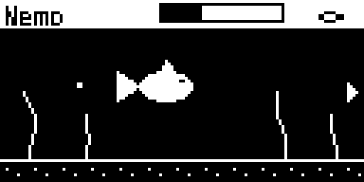
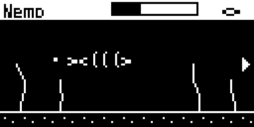

# AQUALINK — Pecera distribuida

Dos peceras digitales hechas con **Raspberry Pi Pico 2 W** y **pantallas OLED**. En ellas vive **un solo
pez**. Al juntar las peceras, un **sensor Hall** detecta el imán de la otra y el pez sale nadando por el
borde de una pantalla y aparece en la otra. Su estado viaja por **Wi-Fi con confirmación (ACK)**, así que
nunca se pierde ni se duplica. Desde un **dashboard web** se puede ver dónde está, alimentarlo y enviarlo
a la otra pecera.

Proyecto final de Laboratorio de Elementos Programables.

| Integrante | No. de cuenta |
|------------|---------------|
| Ana Nickole Cisneros Herrera | 203477 |
| Leslie Yoselin Sánchez Flores | 201831 |

| Pecera A — el pez con figuras | Pecera B — el pez con caracteres |
|---|---|
|  |  |

<sub>Vistas previas generadas en la computadora con el mismo código de dibujo que corre en la Pico.</sub>

## Empieza aquí

1. **[Guía de montaje](docs/guia_montaje.md)**: cinco pasos, cada uno con su programa de prueba y lo que debes ver.
2. **[Conexiones](docs/conexiones.md)**: qué cable va a qué pin. Las dos peceras se cablean igual.
3. **[Diagramas de Wokwi](wokwi/README.md)**: las mismas conexiones en forma visual, y simulables.

## Temas del curso

| Tema | Dónde se usa | Archivo |
|------|--------------|---------|
| **GPIO / interrupciones** | Dos botones con pulsación corta y larga, y el sensor Hall. La interrupción solo guarda la hora del flanco; el bucle decide qué fue | `common/sensors.py` |
| **ADC** | Fotorresistencia para el modo día/noche con histéresis; temperatura interna | `common/sensors.py` |
| **PWM** | Lámpara de la pecera con transición suave y tonos del buzzer | `common/sensors.py` |
| **I2C** | La pantalla OLED SSD1306, con driver propio sobre `FrameBuffer` | `common/ssd1306.py` |
| **Wi-Fi / HTTP / sockets** | Modo STA, UDP para encontrarse, TCP para enviar el pez, dashboard y API | `common/link.py`, `common/web.py` |
| Dual-core (extra) | En la pecera A, un núcleo dibuja y el otro atiende red y botones | `tank/main.py` |
| UART (extra) | Plan B: el pez viaja por cable si falla el Wi-Fi | `common/link.py` |

Son **cinco temas obligatorios** (el mínimo pedido es cuatro) y dos complementarios.

## Materiales

Todo por duplicado: las dos peceras son iguales.

| Material | Cantidad |
|----------|----------|
| Raspberry Pi Pico 2 W | 2 |
| Pantalla OLED SSD1306 128×64 I2C | 2 |
| Botón de 6×6 mm | 4 (dos por pecera) |
| Sensor Hall A3144 o módulo KY-003 (o un reed switch) | 2 |
| Imán de neodimio pequeño | 2 |
| Fotorresistencia (LDR) y resistencia de 10 kΩ | 2 de cada una |
| Buzzer pasivo y resistencia de 100 Ω | 2 de cada uno |
| LED blanco y resistencia de 220 Ω | 2 de cada uno |
| Mini protoboards, jumpers, cables USB y power banks | 2 juegos |

## Controles

| Acción | Cómo | Dashboard |
|--------|------|-----------|
| Tirar comida | **FEED** (GP2), pulsación corta | Alimentar |
| Golpear el vidrio: el pez se asusta | **FEED**, pulsación larga (1 s) | Golpear vidrio |
| Enviar el pez a la otra pecera | **SEND** (GP3), pulsación corta | Enviar |
| Ver IP, enlace, luz y envíos | **SEND**, pulsación larga (1 s) | Siempre visible |
| Modo noche: el pez duerme | Tapar el LDR | — |

El pez tiene hambre: sube un punto cada 30 segundos. Arriba de 70 nada lento y suena una alerta; cada comida le baja 30.

## Estructura del repositorio

```
AQUALINK/
├── README.md
├── common/                  código compartido: va igual en las DOS Pico
│   ├── fish.py              el pez y la pecera (nado, hambre, comida, bordes)
│   ├── tank.py              enlace, envío con ACK, duplicados, órdenes de la web
│   ├── link.py              Wi-Fi, UDP, TCP y la variante por UART
│   ├── web.py               servidor HTTP
│   ├── sensors.py           botones, sensor Hall, LDR, PWM y buzzer
│   ├── ssd1306.py           driver de la pantalla OLED (I2C)
│   ├── render_oled.py       dibujo de la pecera en 128×64
│   └── secrets_template.py  plantilla de las credenciales Wi-Fi
├── tank/                    el programa de las peceras
│   ├── main.py              el MISMO archivo corre en las dos
│   ├── config_a.py          diferencias de la pecera A
│   ├── config_b.py          diferencias de la pecera B
│   └── www/index.html       dashboard
├── pasos/                   programas de prueba para montar paso a paso
├── wokwi/                   diagram.json de cada pecera
├── docs/                    guía de montaje, conexiones, protocolo, pruebas, propuesta
├── tests/test_logic.py      pruebas que corren en la computadora, sin Pico
├── scripts/                 deploy.sh y deploy.ps1: suben todo a la Pico
└── evidence/                fotos y videos de las pruebas
```

## Instalación rápida

Para quien ya tiene MicroPython en las Pico y todo cableado. Si es la primera vez, usa la [guía de montaje](docs/guia_montaje.md).

```bash
cp common/secrets_template.py secrets.py   # escribe tu red Wi-Fi de 2.4 GHz
pip install mpremote
./scripts/deploy.sh a                      # con la Pico A conectada
./scripts/deploy.sh b                      # con la Pico B conectada
```

En Windows: `.\scripts\deploy.ps1 a` y `.\scripts\deploy.ps1 b`.

Después abre `http://IP_DE_A/` desde un celular o laptop en la misma red. La IP aparece en la pantalla al encender.

## Pruebas sin hardware

```bash
python3 tests/test_logic.py
```

Simula dos peceras en la computadora. Comprueba el viaje de ida y vuelta, cinco minutos de cruces sin
pérdidas ni duplicados, qué pasa si falla el envío o si las dos peceras creen tener el pez, y las
respuestas 200, 400 y 409 de la API.

## Ajustes (`config.py` de cada pecera)

| Variable | Para qué sirve |
|----------|----------------|
| `OLED_HEIGHT = 32` | Si tu OLED es de 128×32 en vez de 128×64 |
| `I2C_FREQ` | Baja a `100_000` si la pantalla se ve con ruido |
| `FISH_STYLE` | `"pixel"` (figuras) o `"ascii"` (caracteres) |
| `LINK_MODE = "uart"` | Plan B: usar el cable entre GP0 y GP1 en lugar de Wi-Fi |
| `USE_DUAL_CORE = False` | Si el programa se congela en la pecera A |
| `LDR_INVERT = True` | Si el modo noche se activa al revés |
| `BUZZER_ON = False` | Silenciar |
| `PEER_IP` (en `secrets.py`) | IP fija de la otra pecera, si no se encuentran solas |

## Solución de problemas

| Síntoma | Qué revisar |
|---------|-------------|
| `No encuentro la OLED en el bus I2C` | Los 4 cables; SDA y SCL se confunden fácil. VCC va a **3V3**, no a VBUS |
| La OLED enciende pero no se ve nada | Puede ser de 128×32: `OLED_HEIGHT = 32` |
| No obtiene IP | Nombre y contraseña de la red; que sea de 2.4 GHz |
| Tienen IP pero no se ven entre sí | Misma red, que no sea de invitados; escribe `PEER_IP` en `secrets.py` |
| El dashboard no abre | Escribe `http://IP/`, no `https://`; celular en la misma red y sin VPN |
| Nunca aparece el enlace | Ejecuta `pasos/paso2_entradas.py`: el Hall debe decir `SI` al acercar el imán. El A3144 va a VBUS (5 V) y solo detecta un polo |
| La pecera A se congela | `USE_DUAL_CORE = False` |

## Estado del proyecto

El código se probó en la computadora (lógica del pez, protocolo con sockets reales, servidor web y
dibujo de las pantallas) y el driver de la OLED se probó corriéndolo en el simulador de Wokwi sobre una
Pico 2 W: la pantalla dibuja. **Falta la prueba en el hardware real**, documentada en
[docs/pruebas.md](docs/pruebas.md), con las evidencias en `evidence/`.

## Más documentación

- [Protocolo entre peceras y API HTTP](docs/protocolo.md)
- [Arquitectura y archivos](docs/arquitectura.md)
- [Plan de pruebas y evidencias](docs/pruebas.md)
- [Propuesta final (PDF)](docs/AQUALINK_PROPUESTA_FINAL.pdf)

Inspirado en el video “POV: You give your fish a new tank”. Licencia MIT.
