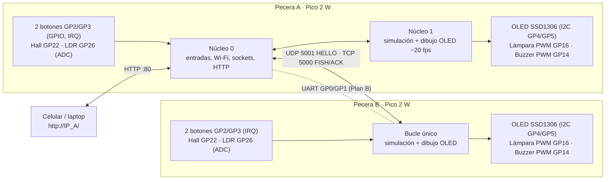

# Arquitectura

Las dos peceras corren **el mismo `main.py`**. Lo que cambia está en `config.py`:
quién crea el pez, quién sirve el dashboard, con qué estilo se dibuja el pez y si se usan los dos núcleos.

## Archivos y responsabilidades

| Archivo | Qué hace |
|---------|----------|
| `common/fish.py` | Modelo del pez y la pecera: nado, hambre, comida, sueño, bordes, guardar y cargar. Sin hardware: se prueba en la computadora. |
| `common/tank.py` | "Cerebro": decide el enlace, manda y recibe el pez con ACK, resuelve duplicados, atiende órdenes de la web. |
| `common/link.py` | Wi-Fi en modo STA, UDP HELLO, TCP FISH/ACK/CMD y la variante por UART. |
| `common/web.py` | Servidor HTTP no bloqueante con rutas, 400/404 y `Content-Length`. |
| `common/sensors.py` | Botones con IRQ (pulsación corta y larga), sensor Hall, LDR con histéresis, temperatura interna, PWM con transición y buzzer no bloqueante. |
| `common/ssd1306.py` | Driver de la pantalla OLED por I2C. Hereda de `FrameBuffer`. |
| `common/render_oled.py` | Dibujo de la pecera en 128×64: barra, algas, burbujas, comida, pez y pantalla de datos. Dos estilos de pez. |
| `tank/main.py` | El programa de las dos peceras: arranque, entradas, red, dashboard y bucle de dibujo. |
| `tank/config_a.py`, `tank/config_b.py` | Las diferencias entre una pecera y otra. Se copian a la Pico como `config.py`. |

## Por qué el pez se dibuja de dos maneras

Las dos pantallas son iguales, así que la diferencia la pone el código: la pecera A dibuja el pez con
figuras (`ellipse` y `poly` del FrameBuffer) y la B con caracteres (`><(((>`). El resto de la escena es
idéntica. Sirve para enseñar en la demo que el modelo del pez no sabe nada de cómo se dibuja: `fish.py`
trabaja con coordenadas de 0 a 1 y cada pecera decide cómo pintarlas.

## Concurrencia en la pecera A

- `aq` (la pecera) se comparte entre núcleos y se protege con un `_thread.allocate_lock()`.
- El núcleo 1 llama a `aq.update(dt)` y copia una "foto" (`snapshot`) para dibujar **fuera** del candado.
- Los eventos (`exit_right`, `eat`, …) se pasan al núcleo 0 en la lista `pending`; el núcleo 0 hace el
  envío por red (que puede tardar) sin congelar la animación.
- Si `_thread` da problemas: `USE_DUAL_CORE = False` y todo corre en un solo bucle.
